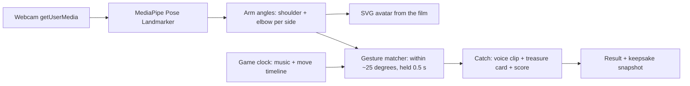

# Pangalay Mirror — project context for the coding agent

## 0. Working rules for the agent (read before touching anything)

1. **A working prototype already exists in `app/index.html`. Extend it. Do not rewrite it, do not add a framework, do not add a build step.** It is one HTML file with one `<script type="module">`. Keep it that way unless the owner asks otherwise.
2. **Never edit anything in `film/`.** It is the deployed concept film and the source of all audio and images. The app loads assets from `../film/`.
3. Make one small change per task, then stop and say how to test it. No drive-by refactors, no renaming, no reformatting.
4. After every change the app must still pass both checks in section 4a. Run them.
5. Do not invent Tausug words or script, and never use Baybayin (section 5).
6. Do not change gesture rules and the avatar rig in the same task; if tracking feels wrong, adjust thresholds in `detect()` only.
7. If something is unclear, ask the owner instead of guessing.
8. For non-trivial features or behavior changes, follow GitHub Spec Kit using `.specify/memory/constitution.md` and the `$speckit-*` skills: specify, clarify meaningful ambiguity, plan, tasks, implement only the reviewed scope, then converge. Review the spec and plan with the owner before implementation. A trivial one-line correction may skip the artifact chain.


Read this first. It is the full hand-off from the concept phase. The owner is Aljabri Alam (Tausug, Technical Lead at VISEO Asia, Singapore; GitHub `aljabrialam`).

## 1. What this is

Pangalay Mirror is an entry for the COMMON GROUND makeathon (11 Oct 2026, SQ Collective, Singapore; Culture × Tech track; teams up to 3; one day; built with Codex).

**One line:** a webcam dance game that teaches pangalay, the traditional dance of the Tausug people of the Sulu Archipelago (southern Philippines), and introduces Tausug culture as you play.

**Why:** the owner is Tausug and wants to preserve Tausug language, art and culture through technology, and introduce his people to an audience that has never heard of them. It must not be "another simple website".

**How it plays (Just Dance format):**
1. The player stands in front of a webcam. An avatar (girl or boy) mirrors their body.
2. A coach avatar shows the moves. Pictograms scroll in a "Next moves" lane.
3. Gold moves are the four taught gestures. Holding a gold gesture "catches" a Tausug treasure.
4. On a catch the dance pauses ("Hold the pose and listen") while a voice names the treasure and tells its story.
5. A closing gesture ends the round, then a result screen, a keepsake snapshot and a thank-you ("Magsukul").

## 2. What exists today (in this folder)

| Path | What it is | Status |
|---|---|---|
| `film/index.html` | A 3:15 self-playing **concept film** of the experience (scripted animation, not the real app). Single file: HTML + CSS + JS, SVG avatars driven by joint angles. | Done, deployed on GitHub Pages |
| `film/*.mp3` | `pangalay.mp3` (music), 19 narration clips (voice: Azure `en-PH-RosaNeural`, generated with the free `edge-tts`) | Done |
| `film/stats.html` | Visit counter page (reads a free Abacus counter: visits / plays / finished) | Done |
| `film/pis-art.png`, `pis-sw.png` | Original pis syabit pattern drawn procedurally (`assets/draw_pis.py`). **Do not** use photos of real cloth; the owner asked for an original drawing. | Done |
| `film/tr0–tr3.png` | Treasure images (kulintangan, pis syabit, pearl shell, kalis), small (≈190 px) | Low-res |
| `assets/avatar_girl.png`, `avatar_boy.png` | Avatars rendered from the film's SVG, transparent, 1500×1770 | Done |
| `graphics/*.png` | Five social graphics (4:5 post, avatar poster, treasures square, 9:16 story, 16:9 banner) | Done |
| `graphics/source/*.dc.html` | Editable sources of those graphics (HTML with inline styles; image `src` values are `/_blob/…` ids from the design tool and will not resolve outside it — swap for files in `assets/`) | Reference |
| `app/index.html` | **Playable prototype**: webcam → MediaPipe pose → arm angles → SVG avatar mirrors the player → gesture rules → catch → voice + treasure card → closing gesture → result. Includes a no-camera demo mode and keyboard overrides. | Works in demo mode; **not yet tested on a real camera** |
| `app/vendor/` | MediaPipe Tasks Vision 0.10.14 (library + wasm), bundled for offline use | Done |
| `app/models/` | Put `pose_landmarker_lite.task` here (see its README); otherwise it loads from the network | To do |
| `docs/VOICE-SCRIPTS.md` | Every narration line and which file holds it | Reference |
| `docs/CAPTION.md` | The social media caption | Reference |

Live film: https://aljabrialam.github.io/pangalay-mirror/ (repo `aljabrialam/pangalay-mirror`, branch `main`, GitHub Pages from root). Stats: `/stats.html`.

**The real webcam app now has a working prototype in `app/` (section 4a). The makeathon work is to test it on a real camera, tune it and polish it.**

## 3. The film's structure (reuse it)

`film/index.html` is the best spec of the experience. Everything is driven by a time `t` in seconds.

Scenes (`SC` array): title 0 · who 5 · where 13.5 · today 27.2 · step 38 · choose 43 · mirror/stance 52.6 · **play 63** · result 143 · keepsake 155 · how 164.6 · maker 178.8 · end 187.8 · total 195.

Avatar rig: `body(kind)`, `arm(k, side, kind)`, `setPose(k, pose)`. A pose is `{l:[shoulder, elbow, wrist], r:[…]}` in **degrees**, 0 = arm hanging down, each joint relative to its parent. Shoulder pivots at (±46, −315) in avatar space; upper arm 80, forearm 75. This rig already takes angles, so the live app only needs to compute the same angles from webcam landmarks.

Gold gestures (`NOTES`, times are seconds into the play scene):

| # | Gesture | Meaning shown | Treasure caught | Target pose `l` / `r` | Hit | Hold |
|---|---|---|---|---|---|---|
| 0 | Open arms | A greeting of welcome and joy | Kulintangan (row of small gongs, cousin of the gamelan) | `[88,4,55]` / `[-88,-4,-55]` | 9.6 | 6.6 |
| 1 | Hands overhead | Triumph and great happiness | Pis syabit (woven headcloth, cousin of songket) | `[150,25,-70]` / `[-150,-25,70]` | 25.5 | 8.5 |
| 2 | Crossed arms | Protectiveness or playfulness | Pearl shell (Sulu pearls once sailed to Singapore) | `[10,-125,-25]` / `[-10,125,25]` | 45.1 | 5.6 |
| 3 | Wrist turn | Arm positions change by turning the wrist | Kalis (wavy-bladed sword, cousin of the keris) | `[35,30,40]` / `[-92,-8,-55]` | 62.1 | 6.5 |

Filler moves (`MIDS`) at 18.4, 36.2, 52.9 use poses `G[0..2]`. Closing gesture "Hands to heart, then bow" at 72.6: `{l:[25,-138,-10], r:[-25,138,10]}` (designed by the assistant as a respectful close; not verified as a traditional pangalay ending).

Scoring in the film: gold 250 each, filler 100 each, total 1,300, 5 stars. Rating word for a gold catch: "Marayaw!" (Tausug for "good").

Audio: one shared `Audio` element plays all narration (`vplay(name)`), unlocked by the first tap. **Keep this pattern**: phones block audio that is not started by a tap, and playing many `Audio` elements at once caused every clip to play together. Music ducks to 0.18 while a voice plays.

## 4. Suggested build for the real app (one day)

Stack: Vite + TypeScript (or plain JS) + `@mediapipe/tasks-vision` Pose Landmarker, static deploy (GitHub Pages or Vercel). No backend.



Build order (riskiest first):
1. Webcam → landmarks → angles → avatar mirrors the player (flip x for mirror).
2. Matcher for the four gestures, with a debug overlay showing live angles.
3. Play screen: music, timeline, catch, voice, score (port from the film).
4. Intro, choose avatar, result, keepsake screens.
5. Polish and test with strangers.

Known risks:
- **Crossed arms:** overlapping arms make landmarks jitter. Use a loose check (wrists past the opposite shoulder).
- **Wrist turn:** body pose does not see wrist rotation. Either add the Hand Landmarker or redefine the gesture as one arm raised forward.
- **QR keepsake:** needs somewhere to upload the photo. Fallback: a "download photo" button.
- **Audio:** needs one "Start" tap before any sound.
- **Venue:** track one person only (largest body), bundle the model file locally in case Wi-Fi is weak. All gestures are arms-only, so waist-up framing is enough.
- **Painted look of the Canva mockup:** do not try to rig painted characters in a day. Use the SVG avatars.

## 4a. The prototype in `app/index.html` (how it works and how to test it)

Run it (camera access needs http://localhost, not a file:// path):

```bash
python3 -m http.server 8000      # run from the project root, the folder that contains app/ and film/
# camera:   http://localhost:8000/app/
# no camera: http://localhost:8000/app/?demo=1
```

Controls: keys **1–4** force gestures 1–4 and **5** forces the closing gesture (demo safety net if tracking fails on stage); **D** toggles a debug box with live angles and which rules are true.

Code map (all in the one module script):

| Function | Job |
|---|---|
| `arm()`, `body()`, `build()`, `setPose()` | The avatar rig copied from the film. Pose = `{l:[shoulder,elbow,wrist], r:[…]}` in degrees. |
| `STEPS` | The five steps (four gold gestures + closing): name, meaning, target pose, audio file names, treasure text and image. |
| `points(lm, aspect)` | MediaPipe landmarks → mirrored points. Landmarks used: 11/12 shoulders, 13/14 elbows, 15/16 wrists, 19/20 index fingers, 23/24 hips. The x axis is flipped so the player's left arm drives the avatar's screen-left arm, like a mirror. |
| `angles(P)` | Points → rig angles. Segment angle = `atan2(-dx, dy)` in degrees (0 = pointing down, positive = toward screen left). |
| `detect(P, A)` | One true/false rule per gesture, deliberately loose. **Tune thresholds here.** |
| `fake(pose)` | Rig pose → fake landmarks. Used by demo mode, the number keys and the self-test. |
| `show(i)`, `hit()`, `finish()`, `reset()` | Game flow: teach (voice) → try (hold 650 ms) → catch (voice + card) → next → closing → result. |
| `say(name, done)` | The single shared voice player. Music ducks while it speaks. |
| `initCamera()`, `loop()` | MediaPipe Pose Landmarker in VIDEO mode, one person, then `frame()` every animation frame. |

Two checks that must keep passing (open the browser console on `/app/?demo=1`):

1. `__selftest()` must return each step matching only its own rule: `open: open`, `overhead: overhead`, `crossed: crossed`, `kalis: kalis`, `heart: heart`.
2. Press Start in demo mode and leave it: it must reach the result screen with score 1,000 and four treasures, with no console errors (about 70 seconds). `__state()` shows progress.

Known gaps, in suggested order:

1. Test on a real webcam and tune `detect()` thresholds (crossed arms and hands-to-heart are the fragile ones).
2. "Wrist turn" is implemented as "one arm out to the side" because body tracking cannot see wrist rotation. Either keep that, or add the Hand Landmarker.
3. No intro screens (who / where / today) and no stance lesson yet; the film has the copy and audio (`intro0–2.mp3`, `stance.mp3`).
4. No Just Dance style timeline or "next moves" lane; the prototype is turn-based (teach, then wait for the player).
5. Keepsake snapshot and QR are not built. Fallback: a "download photo" button that draws the avatar and webcam frame to a canvas.
6. Avatar choice by raising a hand (currently buttons).

## 5. Cultural content rules (important)

- The Tausug are "people of the current" (tau = people, sūg = current), from the Sulu Archipelago, with Jolo at its heart; historically the Sultanate of Sulu.
- **Script:** Tausug was historically written in an Arabic-based script (a local Jawi, "Sulat Sūg"). **Do not use Baybayin** ("Alibata" is a misnomer and it is a Tagalog script, not Tausug).
- Sulat Sūg spellings used so far:

| Word | Script | Confidence |
|---|---|---|
| Magsukul (thank you) | مَغْسُكُلْ | From a published example |
| Marayaw (good) | مَرَيَوْ | From a published example |
| Tau Sūg | تَؤُ سُوْغْ | Assistant's transliteration, unverified |
| Pangalay | فَڠَلَيْ | Assistant's transliteration, unverified |
| Kulintangan | كُلِنْتَڠَنْ | Assistant's transliteration, unverified |
| Pis syabit | فِسْ سِيَبِتْ | Assistant's transliteration, unverified |
| Kalis | كَلِسْ | Assistant's transliteration, unverified |

  Convention followed: every vowel marked, ف for p, غ for g, ڠ for ng. The unverified ones should be checked by someone who reads Sulat Sūg. No Tausug word for "pearl" or "mirror" has been confirmed; do not invent one.
- Do not machine-translate English sentences into Tausug. Add script only to known Tausug words, and keep the English unchanged beside it.
- Pronunciations the owner corrected for the voice: "Koolin-tahng-an" (kulintangan), "Pahng-ahh-lie" (pangalay).
- Each treasure is linked to a cousin in the Malay world (gamelan, songket, keris) and to Singapore (pearl trade), to connect with a Singapore audience.

## 6. Look and feel

Colours: night `#1A0820`, deep `#2A0C2E`, gold `#F2C14E`, paper `#F6EFDF`, mist `#C9D8D6`, rose `#B32E63`, navy `#17324A`, teal sea `#0E4C55`. Pis syabit bands: purple, maroon, green, orange, turquoise.
Type: Gloock (display), Albert Sans (text), Noto Naskh Arabic (Sulat Sūg).
Scene: dusk sky, setting sun, sea, a vinta boat with striped sail, a stilt house.

## 7. Owner preferences

- Copy-paste-ready outputs; Mermaid for diagrams.
- Iterate on what exists; do not rebuild from scratch.
- English text stays as is when adding Tausug script.
- His photo is `assets/me.jpg`; profile line: "Aljabri Alam · Tausug · Technical Lead, VISEO Asia"; LinkedIn `linkedin.com/in/aljabri-alam`.

## 8. To regenerate a voice clip

```bash
python3 -m pip install --user edge-tts
python3 -m edge_tts --voice en-PH-RosaNeural --text "YOUR TEXT" --write-media out.mp3
```

## 9. Open items

- Test and tune the prototype on a real camera (section 4a).
- Verify the Sulat Sūg spellings and the closing gesture with a Tausug elder or teacher.
- Confirm rights to `pangalay.mp3` before wide public use; swap the track if unsure.
- Treasure images are low resolution; replace with larger originals if available.
- The Canva app mockup (11 UI screens, design id `DAHXk_jjAVs`) predates the closing gesture, the script and the maker screen.
