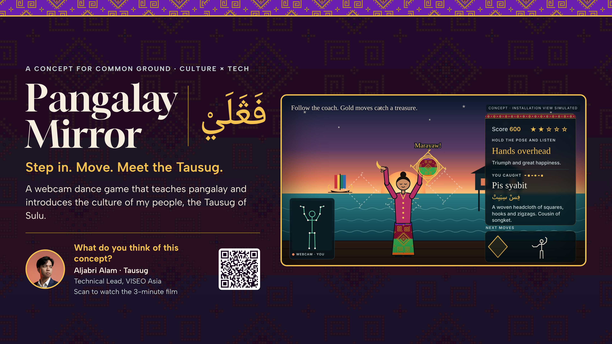
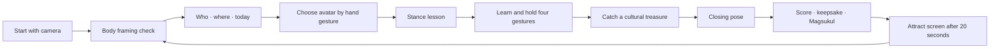

# Pangalay Mirror

**Step in. Move. Meet the Tausug.**



Pangalay Mirror is a webcam dance game that introduces pangalay and Tausug culture through movement. A player follows a coach avatar, mirrors gestures, and catches cultural treasures as they learn. It is being built for the COMMON GROUND Makeathon, Culture × Tech track, in Singapore.

The project has two experiences: a self-playing concept film that tells the story, and a real browser app that uses a webcam and pose tracking. The GitHub Pages root remains the concept film; the playable app is deployed on Vercel.

## For judges — try it in two minutes

| | |
|---|---|
| **Playable app**<br>[pangalay-mirror.vercel.app/app](https://pangalay-mirror.vercel.app/app/) | **No-camera demo**<br>[Open the demo](https://pangalay-mirror.vercel.app/app/?demo=1) |
| **Dance timeline review**<br>[Open the aligned review route](https://pangalay-mirror.vercel.app/app/timeline.html) | **Concept film**<br>[aljabrialam.github.io/pangalay-mirror](https://aljabrialam.github.io/pangalay-mirror/) |
| **GitHub repo**<br>[github.com/aljabrialam/pangalay-mirror](https://github.com/aljabrialam/pangalay-mirror) | **Review checklist**<br>[`docs/REVIEW-BEFORE-SUBMISSION.md`](docs/REVIEW-BEFORE-SUBMISSION.md) |

For the camera app, use HTTPS or `localhost`, allow camera access, and stand back until the app sees your shoulders, elbows, and wrists. In demo mode, the game runs without a camera. Keys **1–4** force the four taught moves, **5** forces the closing gesture, and **D** toggles the tracking debug overlay.

## What the app uses

| | Role | Status |
|---|---|---|
| **Webcam + MediaPipe Pose Landmarker** | Tracks one player's upper body; drives the mirrored avatar and body-framing gate | Built; local pose model bundled. Validate framing and tracking on the event laptop |
| **Gesture game** | Teaches four arm gestures, shows flying treasure targets, catches four treasures, then recognizes a closing pose | Built; demo mode reaches the result at 1,000 points. Real-camera gesture tuning remains |
| **Hand Landmarker** | Checks palm orientation for the wrist-turn gesture | Built with one-arm-out fallback; real-camera check remains |
| **Intro and stance lessons** | Introduces who the Tausug are, where they live, and what the player will learn | Built with the existing narration clips and Skip intro control |
| **Keepsake** | Draws a 1080×1350 PNG with the avatar, approved Magsukul script, and score | Built locally in the browser; inspect the downloaded image on the event laptop |
| **Attract screen** | Returns from results after 20 seconds; a held hand raise begins the next round | Built; real-camera repeat-round check remains |
| **Next-moves lane** | Eight scrolling gold, filler, and closing cues with a fixed marker and Perfect/Good timing feedback | Built in the main `/app/` flow and the aligned timeline review route |
| **Concept film** | A scripted animation of the full experience, built from SVG avatars and narration | Published on GitHub Pages; remains separate from the playable app |

Built for a one-day makeathon. No backend, accounts, or photo upload. The webcam feed is used locally for pose tracking; the keepsake is rendered in the browser and downloaded by the visitor.

## The dance flow



Each gold gesture sends its matching Tausug cultural treasure toward a pose target: kulintangan, pis syabit, pearl shell, and kalis. The target responds as the player holds the pose; a catch pauses the lane while its story plays. Narration and music reuse a single shared audio player. The game supports a no-camera demo and keyboard controls as stage fallbacks.

## What it is and what it is not

| | Current implementation |
|---|---|
| **Playable app** | A static HTML page with inline JavaScript; no framework, backend, or build step |
| **Pose tracking** | MediaPipe Tasks Vision, local JS/WASM bundle, local pose model, and local hand model |
| **Deployment** | Vercel serves `/app/` and redirects its root to the app; the concept film remains on GitHub Pages |
| **Dance lane** | Included in the primary `/app/` game; `/app/timeline.html` remains available as an aligned review route |
| **Tracking limits** | Thresholds and hand-turn behavior still need testing under real camera distance, lighting, and movement |
| **Cultural review** | No Baybayin and no machine-translated Tausug sentences. A few transliterations and the closing gesture still need review by a Tausug reader/teacher |
| **Audio rights** | Confirm public-use rights for `pangalay.mp3` before a wider release |

## Project structure

```text
pangalay-mirror/
├── app/
│   ├── index.html                 Playable webcam game
│   ├── timeline.html              Aligned review route for the main game
│   ├── models/                    Local Pose and Hand Landmarker models
│   └── vendor/                    MediaPipe Tasks Vision JS and WebAssembly
├── film/                           Published concept film, audio, narration, and art
├── assets/                         Avatar art and supporting project assets
├── graphics/                       Social graphics and editable HTML sources
├── docs/
│   ├── VOICE-SCRIPTS.md            Narration copy and clip mapping
│   ├── CAPTION.md                  Social caption
│   └── REVIEW-BEFORE-SUBMISSION.md Camera, offline, and event-device checklist
├── specs/                          Spec Kit feature specs, plans, and tasks
├── .specify/                       Spec Kit constitution, templates, and config
├── AGENTS.md                       Project hand-off and working rules
└── vercel.json                     Root redirect to `/app/` on Vercel
```

## Run locally

Use Python's static server from the repository root. Camera access works on `localhost` or HTTPS, not from a `file://` URL.

```bash
python3 -m http.server 8000
```

Open the camera app at <http://localhost:8000/app/> or the no-camera demo at <http://localhost:8000/app/?demo=1>. The aligned review route is at <http://localhost:8000/app/timeline.html>.

For offline use, both model files and the MediaPipe library/WASM are already in the repo. The fonts have system fallbacks. To verify offline startup, allow camera permission first, turn off Wi-Fi, and reload on the event laptop.

## Spec-driven development

Features are tracked in `specs/` using Spec Kit: specification → plan → tasks → implementation → verification. The project constitution is in [`.specify/memory/constitution.md`](.specify/memory/constitution.md), and the project-specific rules are in [`AGENTS.md`](AGENTS.md).

Feature documents record both simulated checks and owner-only validations. Do not treat a passing demo-mode run as proof that real-camera tracking works; use the [review checklist](docs/REVIEW-BEFORE-SUBMISSION.md) before presenting.

## Cultural and project notes

- Pangalay is a traditional dance of the Tausug people of the Sulu Archipelago.
- English narration stays in English; only known Tausug terms use Sulat Sūg script. Do not add Baybayin or invent translations.
- Some Sulat Sūg spellings in the app are unverified. Have a Tausug reader or teacher review them.
- `film/` is the concept-film source and should not be edited as part of playable-app work.
- The timeline and treasure-target features are part of the default app; `app/timeline.html` stays aligned for direct review.

## Further reading

- [Full project context and working rules](AGENTS.md)
- [Voice scripts and clip names](docs/VOICE-SCRIPTS.md)
- [Makeathon review checklist](docs/REVIEW-BEFORE-SUBMISSION.md)
- [Feature specifications and plans](specs/)
- [Original social graphics](graphics/)
