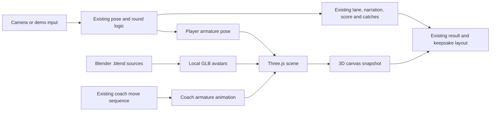

# Implementation Plan: Separate Blender 3D Experience

**Branch**: `015-blender-3d-experience` | **Date**: 2026-10-12 | **Spec**: [spec.md](spec.md)

**Input**: Feature specification from `/specs/015-blender-3d-experience/spec.md`

## Summary

Add an independent static 3D experience at `/app-3d/`. Model and rig lightweight girl/boy avatars in Blender, export them as local GLB assets, and render/animate them in the browser. Start from the existing app as the behavior and cultural-content source, but copy its page into the new route and adapt that copy only. Reuse the existing MediaPipe bundle, models, audio, treasure art, intro copy, score flow, and keepsake content by referencing assets under `app/` and `film/`. Preserve `/app/` and `/app/timeline.html` byte-for-byte.

## Technical Context

**Language/Version**: Browser JavaScript modules in standalone HTML; Blender native project files for character authoring

**Primary Dependencies**: Three.js WebGL renderer and GLTFLoader, local Blender-exported GLB character assets, shared MediaPipe Tasks Vision 0.10.14 assets

**Storage**: Static files only; no backend or participant image uploads

**Testing**: Existing gesture self-test and complete no-camera round, plus visual/model-load checks on `/app-3d/` and reviewed camera play on desktop and mobile

**Target Platform**: Static Vercel route on desktop and supported mobile browsers in landscape

**Project Type**: Browser web app

**Performance Goals**: Maintain responsive pose feedback and readable 3D rendering during a full round on a reviewed phone; keep the combined initial 3D model payload at or below 8 MB

**Constraints**: No framework/build step/backend; do not edit current app routes or `film/`; keep camera access user-initiated and local; deliver low-poly, mobile-friendly assets; three-dimensional depth is not inferred from the existing 2D pose landmarks

**Scale/Scope**: One independent route, two avatar models, a player and coach rendering, reuse existing game content and round logic

## Constitution Check

- Preserve existing app and concept film: **PASS** — new entry and assets live only in `app-3d/`; shared app/film assets are read-only dependencies.
- Browser-first, static deployment, no build or backend: **PASS** — plain HTML/module files and local static assets.
- Camera consent, privacy, and demo: **PASS** — retain existing tap-to-start camera access, local processing, and no-camera demo.
- Cultural integrity: **PASS** — reuse existing copy and visual references; do not add unverified cultural clothing, movement claims, words, or script.
- Behavior verification: **PASS** — tasks require the existing self-test and full demo on the new route; old app routes are regression checked for no changes.
- Owner review before implementation: **PASS** — owner approved the spec and plan and requested Blender setup on this machine.
- Blender availability: **PASS** — Blender 5.2.2 LTS is installed and was used to author/export both avatar assets.

## Phase 0: Research Decisions

See [research.md](research.md). Blender's glTF exporter supports armatures and animation actions; Three.js GLTFLoader loads glTF/GLB scenes and exposes animation clips. Keep the runtime assets local and pin the Three.js module version so `/app-3d/` does not require a runtime CDN request.

## Architecture and Data Flow



- The primary route is a separate `app-3d/index.html` entry point mapped naturally to `/app-3d/` by the existing static Vercel project.
- It begins as a copy of `app/index.html`; only the copy receives 3D rendering changes. This intentionally avoids shared-code refactors that would touch the production route.
- The 3D module loads local `app-3d/models/*.glb` assets and a pinned local Three.js module/GLTFLoader. The pose bundle, WASM, and models are referenced from `../app/`; cultural art/audio are referenced from `../film/`.
- The player avatar's armature follows the same supported arm angles derived from MediaPipe landmarks. Its depth and lower-body pose remain authored/static because the current camera pipeline does not estimate full 3D body pose.
- The coach uses the same existing target poses and timing, played through the Blender rig. Keep current browser UI, move lane, treasure cues, audio player, score, and cultural copy.
- Compose the keepsake from the local camera still, a captured 3D canvas image, and the existing result/profile/QR design. No image is sent to a service.
- On WebGL/model failure, show an accessible explanation and a link to `/app/`; do not silently fall back to the existing route or alter it.

## Project Structure

```text
app-3d/
├── index.html                 # independent 3D experience entry point
├── models/
│   ├── avatar-girl.blend      # editable Blender source
│   ├── avatar-girl.glb        # browser asset
│   ├── avatar-boy.blend
│   └── avatar-boy.glb
├── tools/
│   └── create_avatars.py      # reproducible Blender authoring/export script
└── vendor/
    ├── three.module.js        # pinned local runtime module
    ├── three.core.js          # matching core module required by Three.js 0.180.0
    ├── addons/loaders/GLTFLoader.js
    ├── addons/utils/           # BufferGeometryUtils and SkeletonUtils
    └── LICENSE                # upstream license

app/                           # shared read-only MediaPipe code and models
film/                          # shared read-only approved copy, audio and art
```

**Structure Decision**: Create one standalone static route and a dedicated 3D asset directory. No files in the existing `app/` or `film/` directories are changed by the implementation.

## Implementation Sequence

1. Confirm Blender is available for asset authoring; if not, install/use Blender only after the owner approves this plan and the environment allows it.
2. Create two low-poly stylized avatars in Blender, rig arms to correspond with the existing upper-arm/forearm/wrist pose, and export editable `.blend` sources plus compact GLB models.
3. Create the independent page and load the local Three.js runtime and GLB models. Verify rendering and context-loss recovery before adding camera tracking.
4. Port existing player and coach pose updates to the 3D armature, retaining all existing round, selection, timeline, narration, scoring, and demo behavior.
5. Capture the 3D canvas into the keepsake preview and verify the export remains local.
6. Verify `/app-3d/` on desktop and an actual phone; confirm the original routes have no diff and still pass their required checks.

## Complexity Tracking

No constitution violations. The separate copy of the app is deliberate: sharing runtime code would require changing the existing page, which conflicts with the user's explicit route-isolation requirement.
